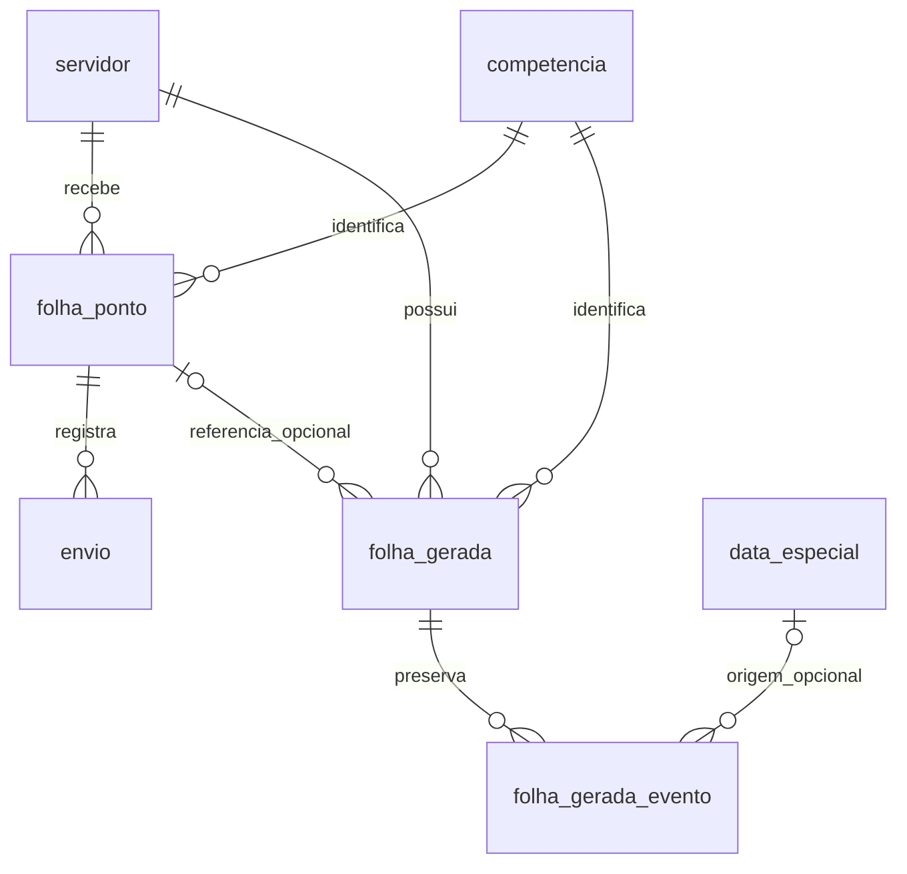

# Alterações do banco — requisito 3.3

## Estratégia e compatibilidade

`database/folha_pontos.sql` é a única definição completa do banco. A migração `database/migrations/002_atualizacao_calendario.sql` contém somente os objetos novos e o controle de aplicação; não recria nem apaga as tabelas anteriores.

Requer PostgreSQL **17 ou superior**, banco com encoding **UTF8**. A normalização usa a collation nativa `pg_catalog."pg_c_utf8"`, independente do locale escolhido na criação do banco. Foi testado em PostgreSQL 18, inclusive com locale C. Versões anteriores do PostgreSQL precisam ser atualizadas antes desta instalação.

Não houve execução sobre o banco real. Os testes utilizam schemas descartáveis em um PostgreSQL isolado.

| Antes | Depois |
|---|---|
| `servidor`: cadastro, matrícula, contato, departamento e carga horária | Preservada integralmente |
| `competencia`: unicidade de mês e ano | Reutilizada pelas folhas recebidas e geradas |
| `folha_ponto`: original recebido, vínculo e resultado OCR | Preservada, inclusive a unicidade professor/competência |
| `envio`: histórico SMTP | Preservada; geração não cria envios |
| `idempotency_request`: deduplicação de envios | Preservada; nenhuma chave anterior é removida |
| Sem calendário ou versões de modelos | Cinco novas tabelas descritas abaixo |

**Tabelas anteriores modificadas: nenhuma.** Não foram adicionadas colunas ou alteradas restrições nas tabelas existentes. A separação entre `folha_ponto` e `folha_gerada` impede que um modelo em branco substitua uma folha recebida ou seja selecionado pelas consultas de envio automático.

## Tabelas adicionadas

### `data_especial`

Eventos do calendário, permitindo vários eventos no mesmo dia.

| Coluna | Tipo / regra |
|---|---|
| `id_data_especial` | BIGINT identity, chave primária |
| `data` | DATE, obrigatório |
| `especificacao` | VARCHAR(300), obrigatório e não vazio após normalização |
| `especificacao_normalizada` | TEXT, coluna gerada e armazenada pelo PostgreSQL |
| `tipo` | VARCHAR(20): FERIADO, RECESSO, PONTO_FACULTATIVO ou OUTRO |
| `criado_em`, `atualizado_em` | TIMESTAMPTZ, obrigatórios, horário atual por padrão |

Identidade: `(data, especificacao_normalizada)`, protegida por `uq_data_especial_identidade`. A função imutável `normalizar_especificacao` unifica espaços, remove espaços nas extremidades, normaliza Unicode em NFC e converte para minúsculas. Acentos são preservados: `Acadêmico` e `ACADÊMICO` correspondem; `academico` é outro texto. Não usa apenas o dia como identidade.

O índice da restrição única inicia por `data` e atende consultas por período. `idx_data_especial_tipo_data(tipo, data)` atende tipo e período. O trigger `trg_data_especial_atualizacao`, com a função `atualizar_data_especial_timestamp`, atualiza o timestamp em edições.

### `importacao_calendario`

Auditoria de cada importação concluída, inclusive reimportações sem novos eventos.

| Coluna | Tipo / regra |
|---|---|
| `id_importacao` | BIGINT identity, chave primária |
| `nome_arquivo` | VARCHAR(255), obrigatório |
| `sha256` | CHAR(64), hash do arquivo importado |
| `total`, `novos`, `atualizados`, `ignorados`, `invalidos` | INTEGER não negativo |
| `detalhes` | JSONB, resultados por linha |
| `criado_em` | TIMESTAMPTZ, horário atual |

`ck_importacao_contadores` exige que total seja igual à soma das quatro categorias. Alterações nos eventos e registro de auditoria são confirmados na mesma transação. O hash é informativo, não uma chave única: corrigir dados e reimportar é permitido. A identidade dos eventos impede inserções repetidas.

### `folha_gerada`

Metadados e histórico dos PDFs em branco. O arquivo binário fica no armazenamento do servidor.

| Coluna | Tipo / regra |
|---|---|
| `id_documento` | BIGINT identity, chave primária |
| `id_servidor` | BIGINT, FK para `servidor`, obrigatório, ON DELETE RESTRICT |
| `id_competencia` | BIGINT, FK para `competencia`, obrigatório, ON DELETE RESTRICT |
| `id_folha_referencia` | BIGINT opcional, FK para a folha recebida que existia na geração, ON DELETE SET NULL |
| `versao` | INTEGER positivo |
| `origem` | VARCHAR(10), sempre GERADA |
| `situacao` | VARCHAR(25), sempre MODELO_EM_BRANCO |
| `modelo` | VARCHAR(50), identificador do layout; inicialmente provisorio-v1 |
| `caminho_arquivo` | TEXT, obrigatório e único, não exposto nas respostas da API |
| `nome_arquivo` | VARCHAR(255), obrigatório |
| `tamanho_bytes` | BIGINT positivo |
| `sha256` | CHAR(64), hash do PDF |
| `dados_professor` | JSONB, cópia do cadastro utilizado na geração |
| `gerado_em` | TIMESTAMPTZ, horário de criação |

`uq_folha_gerada_versao(id_servidor, id_competencia, versao)` impede versões repetidas. A aplicação bloqueia o registro do professor durante a geração para serializar solicitações concorrentes. Uma versão existente causa 409 se não houver autorização explícita `nova_versao: true`.

Índices: `idx_folha_gerada_competencia(id_competencia, id_servidor)` e `idx_folha_gerada_referencia(id_folha_referencia)`, além dos índices de unicidade/PK. `id_folha_referencia` é apenas uma referência histórica opcional: não cria vínculo de aprovação e não é alterado quando uma folha recebida aparece depois.

### `folha_gerada_evento`

Cópia dos eventos efetivamente usados no PDF. Editar o calendário não altera este conteúdo.

| Coluna | Tipo / regra |
|---|---|
| `id_documento` | BIGINT, FK para `folha_gerada`, ON DELETE CASCADE |
| `ordem` | INTEGER não negativo; junto de id_documento forma a PK |
| `id_data_especial` | BIGINT opcional, FK para `data_especial`, ON DELETE SET NULL |
| `data` | DATE, obrigatório |
| `especificacao` | VARCHAR(300), obrigatório |
| `tipo` | VARCHAR(20), os quatro tipos permitidos |

`idx_folha_gerada_evento_origem(id_data_especial)` suporta a referência ao calendário. Excluir um evento apenas zera a referência; data, descrição e tipo históricos permanecem. Não existe exclusão de documentos gerados pela API nesta etapa.

### `schema_migration`

| Coluna | Tipo / regra |
|---|---|
| `versao` | VARCHAR(50), chave primária |
| `aplicada_em` | TIMESTAMPTZ, horário atual |

Registra `002_calendario` no schema completo e na migração. A migração pode ser repetida sem duplicar estruturas; verifica a presença das tabelas e os tipos das colunas essenciais quando encontra o marcador. Um schema parcialmente criado sem marcador causa erro e rollback; não há `IF NOT EXISTS` mascarando objetos incompatíveis. Essa verificação não substitui a revisão de alterações manuais em funções, triggers ou constraints.

## Relacionamentos



## Banco novo

Confira a versão/encoding e crie um banco **vazio**, seguindo o README. Execute somente o schema completo, como o usuário proprietário do banco:

```bash
psql -h localhost -U folha_app -d folha_pontos -v ON_ERROR_STOP=1 -c 'SHOW server_version; SHOW server_encoding;'
psql -h localhost -U folha_app -d folha_pontos -v ON_ERROR_STOP=1 --single-transaction -f database/folha_pontos.sql
```

Não é necessário executar 001 ou 002 em uma instalação nova. O arquivo completo não é um script de atualização e não deve ser aplicado a tabelas existentes.

## Banco antigo

Pare as gravações da aplicação durante a atualização. Ajuste host, usuário e nome do banco nos comandos. Faça backup do banco e também de `data/folhas/`, que contém os arquivos associados:

```bash
pg_dump -h localhost -U folha_app -d folha_pontos -Fc -f folha_pontos_antes_calendario.dump
psql -h localhost -U folha_app -d folha_pontos -v ON_ERROR_STOP=1 -c 'SHOW server_version; SHOW server_encoding;'
psql -h localhost -U folha_app -d folha_pontos -v ON_ERROR_STOP=1 -f database/migrations/001_idempotency_request.sql
psql -h localhost -U folha_app -d folha_pontos -v ON_ERROR_STOP=1 -f database/migrations/002_atualizacao_calendario.sql
```

001 pode ser repetida se a idempotência já estava instalada. 002 usa BEGIN/COMMIT, não executa DROP/TRUNCATE em tabelas antigas e mantém os dados existentes. Se falhar, corrija a incompatibilidade indicada antes de repetir; não exclua tabelas para contornar o erro. Em schemas personalizados, mantenha o mesmo `search_path` da aplicação.

Verificação:

```bash
psql -h localhost -U folha_app -d folha_pontos -c "SELECT * FROM schema_migration WHERE versao='002_calendario';"
psql -h localhost -U folha_app -d folha_pontos -c '\dt'
```

Devem existir as cinco tabelas anteriores e as cinco novas. Após reiniciar a aplicação, abra Calendário, cadastre um evento e recarregue a página. Os endpoints também aparecem em `http://localhost:8000/docs`.

## Testes de equivalência

`tests/test_migracao_calendario.py` compara colunas, tipos, defaults, chaves, checks, índices, triggers e funções entre instalação nova e antiga migrada. Semeia e compara registros de todas as tabelas anteriores, aplica a migração duas vezes e executa cadastro de evento/geração no banco migrado. Testa também estruturas parciais, tabelas ausentes e colunas incompatíveis.

O fixture antigo reutiliza somente o prefixo anterior ao marcador `-- REQUISITO 3.3` do SQL original, preservado nesta alteração. Não existe uma segunda cópia completa do banco.
