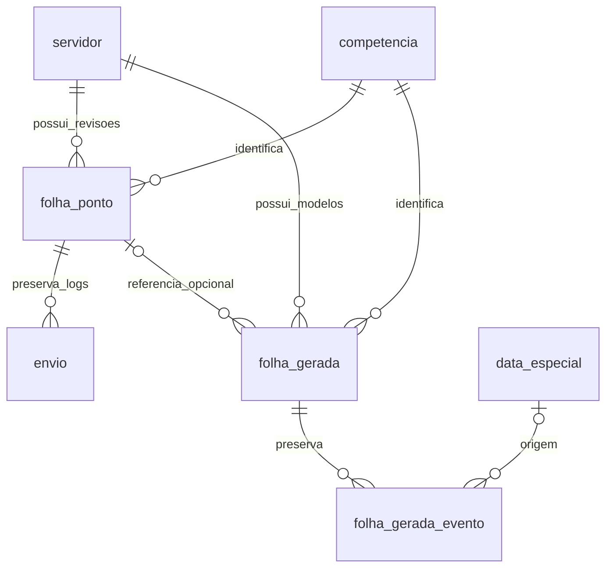

# Banco atualizado e migrações

`database/folha_pontos.sql` contém a instalação completa e independente das migrações anteriores. Bancos existentes usam somente 001 → 002 → 003 → 004 → 005, nessa ordem. Requer PostgreSQL 17+ em UTF-8 (normalização Unicode nativa); testes em PostgreSQL 18.

## Instalação nova

Crie um banco vazio e execute como proprietário:

```bash
psql -h localhost -U SEU_USUARIO -d SEU_BANCO -v ON_ERROR_STOP=1 --single-transaction -f database/folha_pontos.sql
```

Não aplique esse arquivo sobre tabelas existentes. O resultado contém cadastro, competência, recebidas, envios, idempotência, calendário, importações, geração, revisões e lease.

## Banco existente

Pare as gravações da aplicação e faça backup do banco **e dos arquivos em data/folhas/**:

```bash
pg_dump -h localhost -U SEU_USUARIO -d SEU_BANCO -Fc -f antes_integracao.dump
psql -h localhost -U SEU_USUARIO -d SEU_BANCO -v ON_ERROR_STOP=1 -f database/migrations/001_idempotency_request.sql
psql -h localhost -U SEU_USUARIO -d SEU_BANCO -v ON_ERROR_STOP=1 -f database/migrations/002_atualizacao_calendario.sql
psql -h localhost -U SEU_USUARIO -d SEU_BANCO -v ON_ERROR_STOP=1 -f database/migrations/003_integracao_sistema.sql
psql -h localhost -U SEU_USUARIO -d SEU_BANCO -v ON_ERROR_STOP=1 -f database/migrations/004_refinamentos.sql
psql -h localhost -U SEU_USUARIO -d SEU_BANCO -v ON_ERROR_STOP=1 -f database/migrations/005_envio_modelos.sql
```

Se 001/002 já estavam aplicadas, podem ser repetidas conforme as verificações dos respectivos arquivos. 003 é transacional, identifica reaplicação e verifica estruturas essenciais. Objetos parciais sem marcador causam erro/rollback; não há DROP de tabelas ou exclusão de dados. A inicialização da aplicação não migra automaticamente.

Confira:

```bash
psql -h localhost -U SEU_USUARIO -d SEU_BANCO -c "SELECT * FROM schema_migration ORDER BY versao;"
```

Devem constar 002_calendario, 003_integracao, 004_refinamentos e 005_envio_modelos (001 usa seu controle anterior). Em schemas personalizados, preserve o mesmo search_path da aplicação. Para conferir a versão e o encoding, use SHOW server_version e SHOW server_encoding.

## Estrutura preservada

| Objeto | Papel e evolução |
|---|---|
| servidor | Nome, matrícula, CPF opcional legado/único, e-mail, departamento, carga horária e acumulação. CPF continua VARCHAR(11), CHECK de dígitos e UNIQUE quando informado. Novos cadastros/importações exigem CPF na API; não foi aplicado NOT NULL no banco. |
| competencia | Identidade única mes/ano, ano a partir de 2000. Reutilizada por recebidas e geradas. |
| folha_ponto | Documento recebido, vínculos e OCR. 003 adiciona atividade, revisão, metadados e confirmação explícita. |
| envio | Log ligado à revisão recebida, com PENDENTE/ENVIADO/ERRO. O histórico antigo permanece. |
| idempotency_request | Reservas e resultados persistentes de operações. Continua protegendo envio e agora também upload, confirmação de importação e reenvio. |

`DELETE /servidores/{id}` utiliza as FKs RESTRICT e retorna 409 quando há documentos/histórico. Não faz cascade destrutivo. A remoção de recebidas é lógica/arquivada e mantém seus logs/referências.

## Objetos do calendário (002)

**data_especial:** id_data_especial BIGINT identity PK, data DATE, especificacao VARCHAR(300), especificacao_normalizada TEXT gerada/armazenada, tipo VARCHAR(20), criado_em/atualizado_em TIMESTAMPTZ. Identidade única `(data, especificacao_normalizada)`. Tipos permitidos FERIADO, RECESSO, PONTO_FACULTATIVO, OUTRO; descrição não vazia.

`normalizar_especificacao` colapsa espaços, normaliza NFC e converte minúsculas com collation `pg_c_utf8`, preservando acentos. Acentos em maiúsculas também são comparados corretamente em bancos com locale C. `atualizar_data_especial_timestamp` + trigger atualizam o timestamp. Índice `(tipo,data)` complementa o índice único iniciado por data.

**importacao_calendario:** id_importacao BIGINT identity PK, nome_arquivo VARCHAR(255), sha256 CHAR(64), contadores INTEGER não negativos (total/novos/atualizados/ignorados/invalidos), detalhes JSONB e criado_em TIMESTAMPTZ. CHECK exige total igual à soma das categorias. Auditoria e alterações de eventos têm a mesma transação.

**folha_gerada:** id_documento BIGINT identity PK, FKs para servidor e competencia (RESTRICT), id_folha_referencia opcional (SET NULL), versao INTEGER positiva, origem GERADA, situacao MODELO_EM_BRANCO, modelo VARCHAR(50), caminho único TEXT, nome VARCHAR(255), tamanho BIGINT positivo, sha256 CHAR(64), dados_professor JSONB e gerado_em TIMESTAMPTZ. Versão única por servidor/competência. Índices por competência/servidor e referência recebida. Novos PDFs utilizam institucional-v1; PDFs antigos preservam seu identificador de modelo.

**folha_gerada_evento:** PK (id_documento,ordem), FK documento CASCADE, referência opcional ao evento SET NULL, data DATE, especificacao VARCHAR(300), tipo VARCHAR(20). Cópia dos eventos preservada após editar/excluir calendário. Índice da referência ao evento.

**schema_migration:** versao VARCHAR(50) PK, aplicada_em TIMESTAMPTZ. Registra 002, 003 e 004. Não altera registros anteriores de negócio.

## Alterações da integração (003)

### folha_ponto

| Coluna nova | Tipo / regra |
|---|---|
| ativo | BOOLEAN NOT NULL DEFAULT TRUE |
| versao | INTEGER NOT NULL DEFAULT 1, CHECK > 0 |
| tamanho_arquivo | BIGINT opcional, CHECK >= 0 |
| sha256 | VARCHAR(64), opcional para legados |
| atualizado_em | TIMESTAMPTZ NOT NULL DEFAULT CURRENT_TIMESTAMP |
| confirmado_em | TIMESTAMPTZ opcional; não é preenchido automaticamente para folhas antigas |
| resultado_paginas | JSONB NOT NULL DEFAULT [], candidatas/resultados e IDs importados |

A antiga constraint `uq_folha_servidor_competencia` é substituída pelo índice único parcial `uq_folha_ativa_servidor_competencia(id_servidor,id_competencia) WHERE ativo`. Assim podem coexistir a revisão ativa e as arquivadas. Nenhuma folha antiga é removida. Seu ativo inicial é TRUE; confirmado_em fica NULL para não inventar conferência anterior. A interface permite regularizar os vínculos/conferências.

Os arquivos antigos não são movidos pela migração SQL. O tamanho ausente é consultado no arquivo ao listar; a reorganização ocorre ao confirmar/substituir. Recebidas não PDF do fluxo anterior precisam ser reenviadas como PDF para o contrato atual; arquivos/dados legados não são apagados pela migração.

Índices novos: servidor(cpf), envio(id_folha,id_envio DESC) e o índice único parcial das ativas. CPF já possuía índice de unicidade; o índice explícito adicional não altera essa regra.

### importacao_servidor_preview

Token UUID PK, registros JSONB, criado_em TIMESTAMPTZ, expira_em TIMESTAMPTZ, confirmado_em TIMESTAMPTZ opcional e resultado JSONB opcional. A prévia persiste somente esse estado temporário e não altera servidores. Expira após 15 minutos. Confirmar bloqueia/revalida os registros no PostgreSQL e grava os contadores efetivos. Resultado persistido evita reaplicar o token. Registros de prévia expirados permanecem auditáveis; não existe rotina automática de limpeza.

Índice: expira_em.

### sistema_lock

Uma linha de controle: id INTEGER PK com CHECK id=1, owner_token UUID opcional, acquired_at TIMESTAMPTZ e expires_at TIMESTAMPTZ. A migração cria a linha vazia. Adquirir, renovar e liberar são atômicos. Mutações HTTP mantêm bloqueio dessa linha até concluir, evitando mudança de holder no meio de uma operação; consultas permanecem disponíveis. O lease expira em 45 segundos e a interface renova a cada 10 segundos.

A tabela é compartilhada entre processos/usuários, não uma variável de memória do frontend. O identificador da sessão não representa autenticação.

## Relações e compatibilidade



Modelos em branco continuam separados das folhas recebidas e não entram nas consultas de envio. O índice parcial mantém a unicidade do vínculo ativo. FKs e logs ligados às revisões antigas permanecem válidos. Testes comparam colunas/defaults/chaves/índices/funções/triggers do schema novo e das migrações, preservam os valores anteriores e exercitam reaplicação e geração no banco migrado.

## Refinamentos 004: jornada e prévia PDF do calendário

O schema completo agora declara as colunas/regras diretamente em CREATE TABLE, sem ALTERs de integração no fim. A migração [004_refinamentos.sql](../database/migrations/004_refinamentos.sql) atualiza somente bancos existentes após 003. É transacional e detecta reaplicação.

`ck_servidor_carga_horaria` passa a exigir `carga_horaria IS NULL OR carga_horaria IN (20,40)`. NULL permanece permitido para legados; API de cadastro exige jornada e a edição não remove uma jornada informada. Acumula cargo continua BOOLEAN, sem criar coluna duplicada.

Antes de impor a regra, a migração procura jornadas fora do conjunto. Se encontrar, aborta exibindo IDs, matrículas e cargas; não converte 35 em 40 nem apaga registros. Para consultar antes de migrar:

```sql
SELECT id_servidor, nome, matricula, carga_horaria
FROM servidor
WHERE carga_horaria IS NOT NULL AND carga_horaria NOT IN (20,40)
ORDER BY id_servidor;
```

Confira os dados reais e corrija os registros explicitamente; só depois reaplique 004. Não execute o schema completo sobre seu banco existente. Servidores, folhas, envios, eventos e documentos gerados são preservados.

Nova tabela `importacao_calendario_preview`: token UUID PK, nome_arquivo VARCHAR(255), sha256 CHAR(64), registros JSONB, criado_em/expira_em TIMESTAMPTZ, confirmado_em e resultado JSONB opcionais. Índice em expira_em. Expira após 15 minutos. Armazena somente a prévia PDF; eventos e auditoria são gravados juntos ao confirmar o token. A chave idempotente utiliza a tabela já existente idempotency_request. Tokens expirados não possuem limpeza automática.

A geração/ZIP usa variáveis de ambiente e não precisa de tabelas novas. O iniciar.sh verifica 004 sem aplicá-la automaticamente.

## Atualização autorizada pelo iniciar.sh

O diagnóstico do inicializador identifica arquivos pendentes. `bash iniciar.sh --verificar` não executa migrações. Após backup, `bash iniciar.sh --migrar` autoriza somente as pendentes. No terminal interativo, executar sem flags oferece confirmação explícita quando necessário; a resposta padrão é não. Não recria tabelas de uma instalação existente nem converte jornadas incompatíveis. O banco sem tabelas continua exigindo instalação nova pelo schema completo. O diagnóstico está em backend/startup.py.

## 005: histórico de envio de modelos em branco

[005_envio_modelos.sql](../database/migrations/005_envio_modelos.sql) é transacional e reaplicável, exige 004 e preserva os logs anteriores. Adiciona envio.id_documento BIGINT, FK para folha_gerada ON DELETE RESTRICT; id_folha passa a aceitar NULL, mas CHECK num_nonnulls(id_folha,id_documento)=1 exige exatamente uma origem. Assim, recebidas continuam referenciadas como antes e modelos em branco têm seus próprios documentos no mesmo histórico.

Índice (id_documento,id_envio DESC) auxilia consulta/deduplicação. Índice único parcial (id_documento,lower(email_destino)) WHERE id_documento IS NOT NULL AND status_envio=PENDENTE protege reservas concorrentes. A reserva mantém lock curto no modelo até registrar PENDENTE; SMTP acontece após commit. O envio não modifica os modelos ou cria folhas recebidas. Dados e credenciais reais não são utilizados nos testes.

O schema completo declara essas regras diretamente; o inicializador agora exige 005. Depois de backup, `bash iniciar.sh --migrar` aplica somente as pendentes. Esta entrega não aplicou migrações no banco real.
